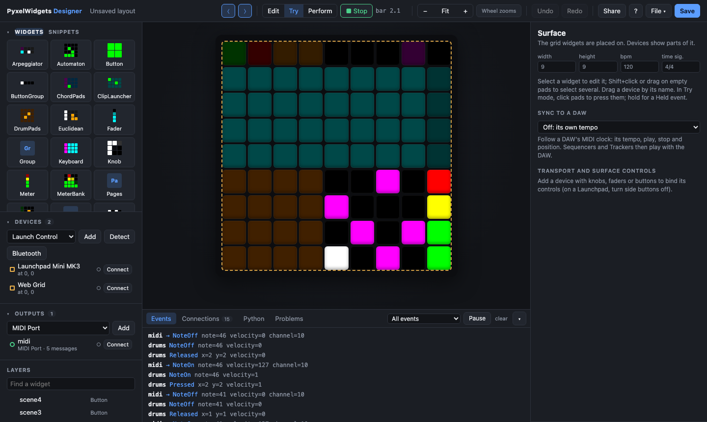

# The designer

The designer is where layouts are made: widgets on a grid, the devices that
show them, the outputs they send to, and how they change each other. It runs
in your browser (`pyxelwidgets designer layout.json`), in a window of its own
(`pyxelwidgets app`, see [apps](apps.md)), or on a phone in the Android app.
New to it? [Getting started](getting-started.md) builds a first controller
step by step.

## Starting

On an empty layout the start window offers:

- **Templates:** a drum controller, a MIDI keyboard, a DAW mixer, a
  performance layout and a macro board. Each one works as it is, and you can
  change it.
- **Devices:** *Detect connected devices* finds controllers that are plugged
  in. The first one you add sets the grid's size, and the window suggests
  snippets that fit it.
- **Outputs:** a MIDI port, Mackie Control or REAPER, so the layout plays
  your software.

**File → New** brings the window back. The File menu also has Open, recent
files, Save, Save As (both with the system's file dialogs), Download, and
Import from this computer.

## Devices and outputs

The layout's devices and outputs connect as they're added: devices show the
layout as you edit it and their pads play it, and outputs send. Each one's row
has a light for its state and a *Connect*/*Disconnect* button. With
`--offline` nothing connects until you press *Connect*.

- **Detect** finds the controllers plugged in. Unplugging one and plugging it
  back in reconnects it.
- **Bluetooth** scans for Bluetooth MIDI devices, connects them (and pairs
  them on Android). Connected ones are remembered and come back by themselves.
  See [Bluetooth MIDI](outputs.md#bluetooth-midi).
- **Check this device** (in a connected device's panel) walks you through
  its corners, pads, colors and controls, then makes a report to send back.
  Please do this for devices marked untested in [hardware](hardware.md).
- MIDI port fields pick from the ports the computer has (*Scan* looks again),
  or take a typed name.

## Widgets

- **Add:** drag a widget from the palette onto the grid, or click it to add it
  in the selected group. Widgets keep their values while you edit.
- **Snippets** (the tab next to Widgets) are ready-made pieces with their
  links and messages, for common grid sizes: 8x8 (a drum machine, a melody
  editor, chords and arpeggios, a Mackie mixer...), 8x2 (Launchkey and Launch
  Control pads), 8x5 (APC40), 9x9 (a Launchpad with its side buttons), 4x4,
  and strips for the side of a grid. The bigger ones are small instruments:
  16 sequencers picked from a 4x4, a step editor, a Euclidean, melody or
  arpeggiator workstation, a snapshot mixer. *Save selection* keeps the
  selected widgets as a snippet of your own (in `~/.pyxelwidgets/snippets`, or
  `--snippets FOLDER`). [Snippets](snippets.md) lists them with pictures.
- **Properties** are generated from each widget's options. Rarely changed
  ones are under *More options*, and changed ones are marked with a dot. The
  ƒ button next to an option turns it into a formula, such as
  `{roll.steps - roll.width}`, recomputed when what it reads changes.
- **Select several:** Shift+click, or drag over empty pads, then move, edit,
  duplicate, group (Ctrl/Cmd+G) or delete them together.
- **Layers:** drag to reorder, or onto a group to move inside. Groups fold.
  Double-click a name (or F2) to rename. Search by name. The eye hides a
  widget in the designer only; the lock keeps it from being dragged.
- **Copy and paste** (Ctrl/Cmd+C, X, V) carry widgets with their messages and
  links, also between layouts.
- **Sprites** are painted frame by frame in the *Frames* section, and any
  widget can get an animation (blink, pulse, fade).

## Messages, links and controls

A widget's *Behaviour* section lists what it does and what changes it:

- **Messages** go to outputs: a note when a pad is pressed, a control change
  when a fader moves, a Mackie Control command, a plug-in parameter by name,
  a keyboard shortcut. Fields are constants or values from the event (the
  pad's velocity, its cell, the fader's value), and *feedback* lets what the
  software sends back update the widget. *Learn* fills a message in from the
  next one the output receives. Adding a NoteOn adds its NoteOff.
- **Links** change other widgets when this one does: a button shows a page, a
  fader sets the tempo, a ButtonGroup cell picks a sequencer. A link's value
  can be a constant, a value from the event, a condition ("1 when cell is 3,
  else 0"), a pick from a list, or a formula. A link to the *Debug log* writes
  text to the event log. A link can also set a device's control light (a
  color; transparent gives it back to what the control shows) or the text on
  its screen (MiniLab 3, Launchkey MK3): they're listed under the device in
  the target list.
- **Controls:** knobs, faders and buttons of a connected device can be bound
  to a widget (*control*), and to the transport and surface actions on the
  Surface panel. *Learn* takes the next control you move. A control can also
  send messages and start links itself: select the device, pick the control
  (or *Learn* it) under *Messages and links*, then *Add message* or *Add
  link*. These rules stay when widgets are deleted and go with their device.

**M** (or *Editor* in the toolbar) opens the messages and links window: every
rule of the selected widgets, or of all widgets and controls. Its first column
lists every widget and device to pick from (Shift or Ctrl/Cmd+click adds
widgets; a device shows its controls and the one new rules start from). Click,
Shift+click and Ctrl/Cmd+click pick rules, and
picked ones are edited together. Copy them onto other widgets, duplicate them,
delete them.

On the grid, the selected widget's link targets are outlined in purple, and
what changes it in green. The drawer's *Connections* tab is a table of
everything.

## Trying and playing

- **Try** mode (T) presses pads with the mouse. The drawer's *Events* tab
  shows what each widget emits and what goes to the outputs. Hovering a pad
  shows what it would send.
- **Play** starts the transport (Space). The tempo and time signature are on
  the Surface panel.
- **Sync to a DAW** (Surface panel) follows a DAW's MIDI clock instead: over
  a virtual port, a MIDI input, or an output such as network or Bluetooth
  MIDI. See [following a DAW's clock](outputs.md#following-a-daws-clock).
  **Send MIDI clock** sends the transport's clock out through outputs instead,
  for a DAW or drum machine to follow.
- **Perform** mode (P) stops drawing the grid, so it costs almost nothing
  while you play on your devices. *Play on this screen* turns the page into a
  touch grid (a Web Grid on the layout), handy on a tablet or phone.
- **Share** (toolbar) lets other computers on your network open the designer,
  e.g. to edit a Raspberry Pi's or a phone's layout from a laptop. The address
  carries a key. Only share on networks you trust: anyone with the address can
  edit and save files.

## The drawer

Under the grid (` shows or hides it, drag its edge to resize):

- **Events:** what the widgets emit, filtered by widget or event kind; pause
  to read.
- **Connections:** every message, link, binding and feedback, by widget.
- **Python:** a program for the current layout, either loading the layout file
  or building the same surface in code (*Standalone*), with or without
  handlers. Carry on from there when a layout outgrows the designer.
- **Problems:** links to missing widgets, outputs without ports, devices that
  aren't plugged in, widgets past the grid's edge. The ⚠ count in the toolbar
  says how many.

## The view

The grid fills the space it has. The zoom buttons sit at its top right. The
wheel zooms around the pointer (*Wheel zooms* next to them switches it to
moving the grid), and so do pinches, Ctrl/Cmd + wheel and Ctrl/Cmd +/-/0.
*Fit* brings it back. Drag around the
grid, Shift + wheel or the middle button to move it. Hide or resize the side
panels; F shows the grid alone.

## Keyboard shortcuts

| Keys | |
|------|-|
| E, T, P | Edit, Try or Perform mode |
| Alt + click | press a pad while editing |
| Space | play or stop |
| Ctrl/Cmd + Z, Ctrl/Cmd + Shift + Z | undo, redo |
| Ctrl/Cmd + S | save |
| Ctrl/Cmd + C, X, V, D | copy, cut, paste, duplicate |
| Ctrl/Cmd + A | select everything in the group |
| Ctrl/Cmd + G, Ctrl/Cmd + Shift + G | group, ungroup |
| Arrows, Shift + arrows | move, resize |
| Delete | delete |
| F2, double-click a layer | rename |
| [ and ] | hide or show the left or right panel |
| F | the grid alone |
| ` | the drawer |
| M | the messages and links window |
| Escape | select nothing |
| ? | all shortcuts |

## Presets in the layout

What a *Presets* group stores is saved in the layout: the designer adds it
when you save, and `pyxelwidgets run` writes it back to the file as you store
(turn the group's `save` option off to keep presets for the session only).
*Clear stored presets* in its panel empties them.
