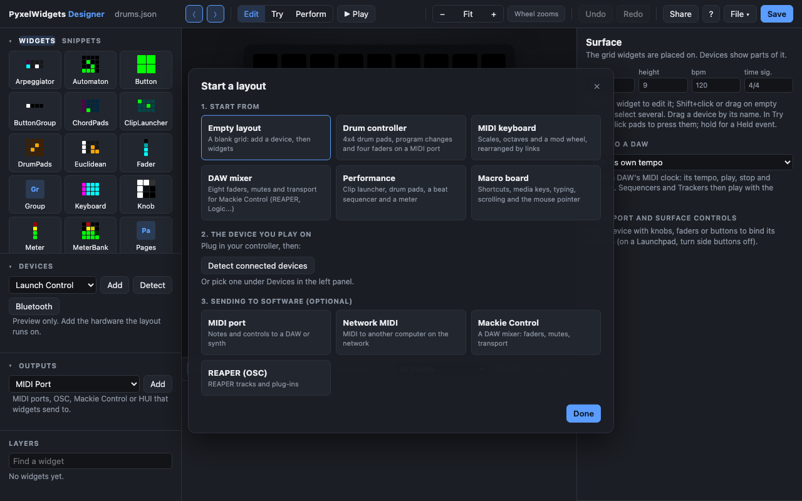
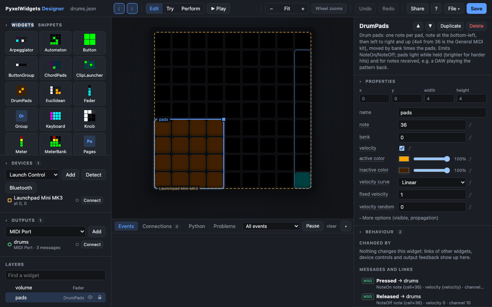
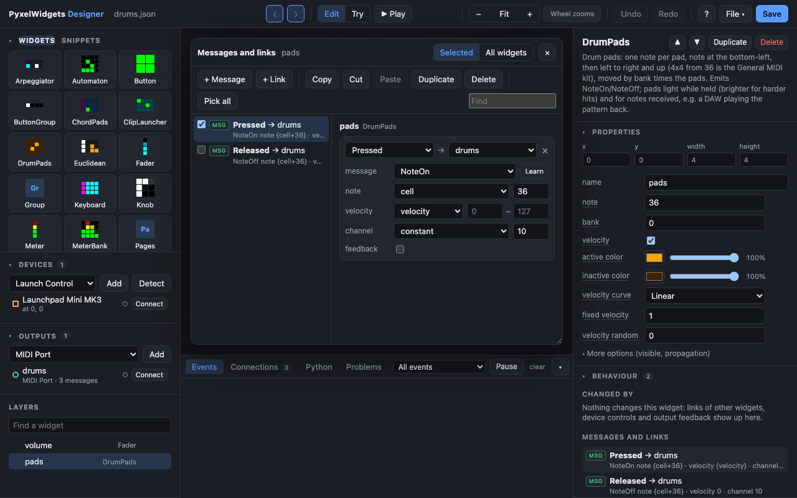
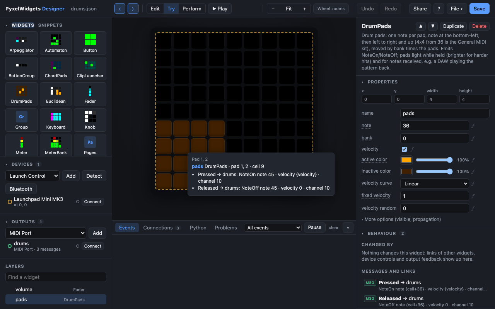

# Getting started: your first controller

This guide builds a small drum controller in the designer, with no code: pads
that play drums in your DAW and a fader for the volume. Then it runs it
without the designer. You need a grid controller (a Launchpad, an APC Mini…)
or just the browser.

## 1. Install and open the designer

PyxelWidgets needs Python 3.10 or newer. In a terminal:

```sh
pip install pyxelwidgets
pyxelwidgets designer drums.json
```

The designer opens in your browser, and `drums.json` is where your layout
will be saved (it is created the first time you save).

## 2. Start a layout



On an empty layout the start window asks how to begin:

1. **Start from:** *Empty layout*, or a template (a drum controller, a MIDI
   keyboard, a DAW mixer…) that already works and that you can change.
2. **The device you play on:** plug in your controller and press *Detect
   connected devices*, then *Add* it. The grid takes the device's size, and
   the window suggests ready-made pieces that fit it ([snippets](snippets.md)).
3. **Sending to software:** add a *MIDI port* to play your DAW or a synth,
   *Mackie Control* to drive a DAW's mixer, or *REAPER (OSC)*.

For this guide: add your device, add a MIDI port, then press *Done*.
You can bring the window back with **File → New**.

## 3. Add widgets

Widgets are the things on the grid: pads, faders, knobs, sequencers, keyboards.
Drag **DrumPads** from the palette on the left onto the grid, and a **Fader**
next to it. Drag a widget to move it, and its corner to resize it.



Selecting a widget shows its **properties** on the right. Hover an option's
name to see what it does. Options you changed are marked with a dot; *reset*
puts one back.

## 4. Send notes to your DAW

In the selected widget's **Behaviour** section, press *Add message*. For the
drum pads the designer suggests a note per pad (36, 37…, the General MIDI drum
kit) with the velocity of your press, plus a note-off when you let go.



The messages and links window lists what the selected widgets send. Each
message says **when** (pressed, released, changed), **where** (the output) and
**what** (the note, channel and so on). A value can come from the event, such
as the pad that was pressed (`cell`) or the fader's position (`value`).

**Learn:** with the output connected, press *Learn* next to the message type,
then move something in your DAW. The message fills itself in with what the DAW
sent (its channel, controller number, OSC address…) and keeps the values your
widget sends.

In your DAW, pick the virtual MIDI port the output created (*PyxelWidgets
midi*, or the name you gave it) as a MIDI input.

## 5. Try it

Switch to **Try** at the top, then press pads on the screen or on your
controller. The *Events* tab under the grid shows what happens.



In Try mode, hovering a pad tells you what it does: the widgets a press
reaches and the messages they send, worked out for that pad.

**Knobs and faders on your controller:** select a widget, then under
*control* press **Learn** and move the knob, fader or button you want. On a
Launchpad, turn the device's *side buttons* option off to use its round
buttons as controls. Bound buttons light up with what they control, knobs
with LED rings show their widget's value, and a controller's screen shows the
widget a knob moved and its value. Bind one
to **show widgets** (in the Surface panel's *Transport and surface controls*) to light up
every widget's area in its own color for a moment.

## 6. Save and play

Press **Save** (Ctrl/Cmd+S). To play the layout without the designer:

```sh
pyxelwidgets run drums.json
```

It connects your devices and outputs, waits for a controller that isn't
plugged in yet, and reconnects one that was unplugged. Press Ctrl+C to stop.
`--play` also starts the transport, for sequencers.

## Where to go from here

- **[Snippets](snippets.md):** step sequencers, mixers, clip launchers,
  arpeggiators and more, ready to drop on the grid.
- **Links** (*Add link* in Behaviour): one widget changing another, such as a
  button showing a page, a knob moving a keyboard's octave, or a pad picking which
  sequencer is shown.
- **Formulas:** press *ƒ* next to an option to compute it from other
  widgets' options, e.g. a Stepper's maximum `{roll.steps - roll.width}`
  for scrolling a 32-step PianoRoll named `roll` column by column; it keeps up
  when the roll changes. Text options take formulas inside them (`Step
  {roll.column + 1}`), and link values and message fields can be formulas of
  the event's values too (*formula…* in their value list: `{note + 12}`).
- **Pages and Presets:** *Pages* shows one page of widgets at a time; *Presets*
  stores what the widgets inside show and brings it back, and keeps it in the
  layout file.
- **Sync to a DAW** (the Surface panel, when nothing is selected): follow
  your DAW's tempo and play/stop through MIDI clock.
- **Python** (the tab under the grid): the code for your layout, to continue
  from when you want more than the designer does.

## When something doesn't work

- **The device isn't found:** check it's plugged in and not open in another
  program that holds its MIDI port exclusively. The device list shows why it
  couldn't connect. Use *Connect* there to try again.
- **The DAW gets nothing:** the output needs *Connect* (green dot), and the
  DAW has to listen to its port. On macOS you can also use the *IAC Driver*
  (Audio MIDI Setup) and give the output its port name.
- **Keyboard and mouse output on macOS:** allow your terminal in *System
  Settings → Privacy & Security → Accessibility*.
- **Lights in the wrong place, wrong colors, a knob that does nothing:** your
  device may not have been tested on real hardware yet (the author has a
  Launchpad Mini MK3). Select it, press **Check this device…** and follow the
  steps; then share the report it makes, so it can be fixed.
- **The Problems tab** under the grid lists what won't work as the layout is.
