# Snippets

Ready-made pieces in the designer's **Snippets** tab (next to Widgets): widgets with their links
and messages. Pick a size there, then click one to add it at the corner of the selected group, or
drag it onto the grid. Messages go to an output of the same kind when the layout has one; otherwise
the snippet adds its own. Select widgets and press *Save selection* to make snippets of your own.

Sizes are width x height: 8x2 is two rows of eight pads, 2x8 two columns.

*Generated by `python docs/build_guide.py` from `src/pyxelwidgets/designer/snippets`.*

## Drums

### Drum machine (8x8)

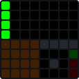

Four 8-step lanes (kick, snare, hats), drum pads, a swing knob, play and tap tempo.

Sends to: `midi_port.MidiPort`.

### Euclidean drums (8x8)

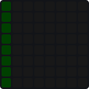

Eight voices of evenly spread hits from note 36: press a pad to set the hits.

Sends to: `midi_port.MidiPort`.

### Euclidean workstation (8x8)

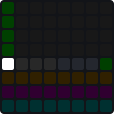

Four Euclidean voices (notes 36-39) with controls: pick a voice (top left), then set its hits, rotation and length on the rows below; play on the right.

Sends to: `midi_port.MidiPort`.

### Drum lanes (8x5)

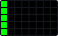

Five 8-step lanes: kick, snare, clap and hats.

Sends to: `midi_port.MidiPort`.

### Euclidean rhythms (8x5)

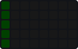

Five voices of evenly spread hits from note 36.

Sends to: `midi_port.MidiPort`.

### 16 drum pads (8x2)

Sixteen pads from note 36 (the General MIDI kit).

Sends to: `midi_port.MidiPort`.

### Drum pads (4x4)

A 4x4 General MIDI kit from note 36.

Sends to: `midi_port.MidiPort`.

## Sequencing

### 16 sequencers (8x8)

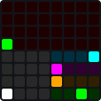

Sixteen 32-step drum sequencers (notes 36-51), one shown at a time: the 4x4 pads bottom left pick it. Its rows on the bottom right: length (8, 16, 24, 32), direction (forward, back, ping-pong, random), swing, gate. All sixteen keep playing.

Sends to: `midi_port.MidiPort`.

### Step editor (8x8)

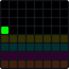

A 32-step drum sequencer whose steps each have a sound, velocity, chance and ratchets: hold steps, then tap the velocity (row 4), chance (row 3), ratchets (row 2, 1-8 hits) or sound row (kick, snare, hats, clap, tom, crash, ride).

Sends to: `midi_port.MidiPort`.

### 16-step sequencer (8x2)

Sixteen steps on two rows, playing note 36.

Sends to: `midi_port.MidiPort`.

## Melody

### In-key keyboard (8x8)

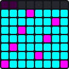

Only the notes of the key, rows a fourth apart (as on the Push); octave buttons on top.

Sends to: `midi_port.MidiPort`.

### Melody editor (8x8)

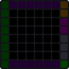

A piano roll in C major with scroll and octave buttons and play on the right.

Sends to: `midi_port.MidiPort`.

### Melody workstation (8x8)

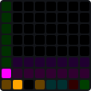

A piano roll with its scale on a row of pads (major, minor, dorian, mixolydian, phrygian, the pentatonics, harmonic minor), an octave stepper, scrolling, tap tempo and play.

Sends to: `midi_port.MidiPort`.

### Chromatic fourths (8x5)

Every semitone, rows a fourth apart (like a bass or guitar).

Sends to: `midi_port.MidiPort`.

### Mini piano (8x2)

White keys on the bottom row, black keys above.

Sends to: `midi_port.MidiPort`.

### Octave stepper (8x1)

An octave from 0 to 8 a step at a time; link its Changed to a keyboard's octave.

## Chords

### Arp station (8x8)

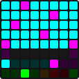

An in-key keyboard playing an arpeggiator (the row under it shows and holds its notes). Controls: mode (up, down, both, random, as played), octaves (1-3), gate, latch, clear, tap tempo, play.

Sends to: `midi_port.MidiPort`.

### Chords and arpeggios (8x8)

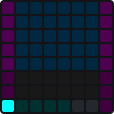

Chord pads feeding an arpeggiator; its mode (up, down, both, random, as played) and latch on the bottom row.

Sends to: `midi_port.MidiPort`.

### Arpeggiator (8x2)

Hold notes to arpeggiate them, up and down over two octaves.

Sends to: `midi_port.MidiPort`.

### Chord strip (8x2)

Triads on the bottom row, sevenths on the top, in C major.

Sends to: `midi_port.MidiPort`.

## Clips

### Clip launcher with scenes (9x9)

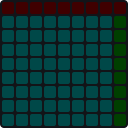

Eight scenes of eight tracks, scene buttons on the right, stops on top (top right stops all).

Sends to: `midi_port.MidiPort`.

### Clip launcher (8x8)

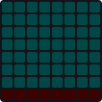

Seven scenes of eight tracks; the bottom row stops a track.

Sends to: `midi_port.MidiPort`.

### Clip launcher (APC40) (8x5)

Five scenes of eight tracks.

Sends to: `midi_port.MidiPort`.

## Mixing

### Mixer with side buttons (Mackie) (9x9)

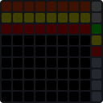

Eight faders with mutes, solos and record arms above; banks and transport on the side.

Sends to: `mackie.MackieControl`.

### Mixer (Mackie Control) (8x8)

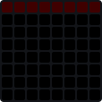

Eight faders with mutes above them, following the DAW (REAPER, Logic, Cubase...).

Sends to: `mackie.MackieControl`.

### Snapshot mixer (8x8)

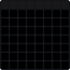

Eight faders (CC 20-27) under a strip of eight snapshots: press an empty one to store, a stored one to bring the faders back (sending their values), hold one to store over it.

Sends to: `midi_port.MidiPort`.

### Fader pair (2x8)

Two faders sending CC 7 on channels 1 and 2.

Sends to: `midi_port.MidiPort`.

### Mutes and solos (Mackie) (8x2)

Solo buttons over mute buttons for eight tracks.

Sends to: `mackie.MackieControl`.

### Stereo meter (2x8)

Two level meters; send them levels from a mapping (x picks the meter) or links.

### Track select (Mackie) (1x8)

Selects one of eight tracks in the DAW, top to bottom.

Sends to: `mackie.MackieControl`.

## Transport

### DAW transport (Mackie) (8x1)

Rewind, forward, stop, play, record, cycle, click and undo in the DAW, lit as it is.

Sends to: `mackie.MackieControl`.

### Transport column (1x8)

Play, stop, back to the start, tempo up and down, and tap tempo, for the app's transport.

## Effects

### XY pad (8x8)

Two controls at once (CC 1 and 2); springs back to the middle when let go.

Sends to: `midi_port.MidiPort`.

### Four knobs (2x8)

Four knobs sending CC 21 to 24 (hold a pad to turn).

Sends to: `midi_port.MidiPort`.

### Four knobs (4x4)

Four knobs in a square, CC 21 to 24.

Sends to: `midi_port.MidiPort`.

### Small XY pad (4x4)

CC 1 and 2 from one pad.

Sends to: `midi_port.MidiPort`.

## Generative

### Generative (Life) (8x8)

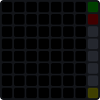

Notes from Conway's Life in C minor pentatonic; reseed, clear and pause on the right.

Sends to: `midi_port.MidiPort`.
